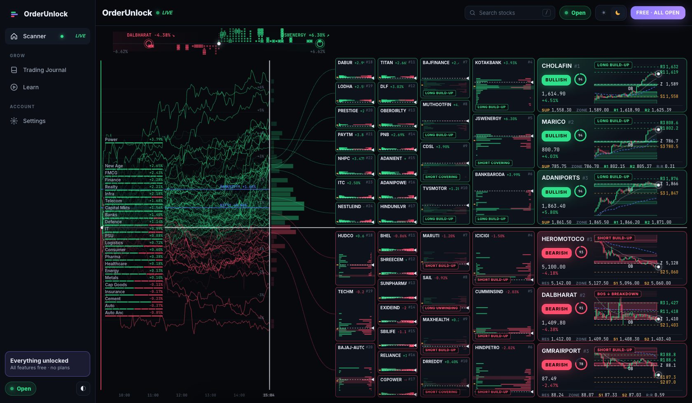
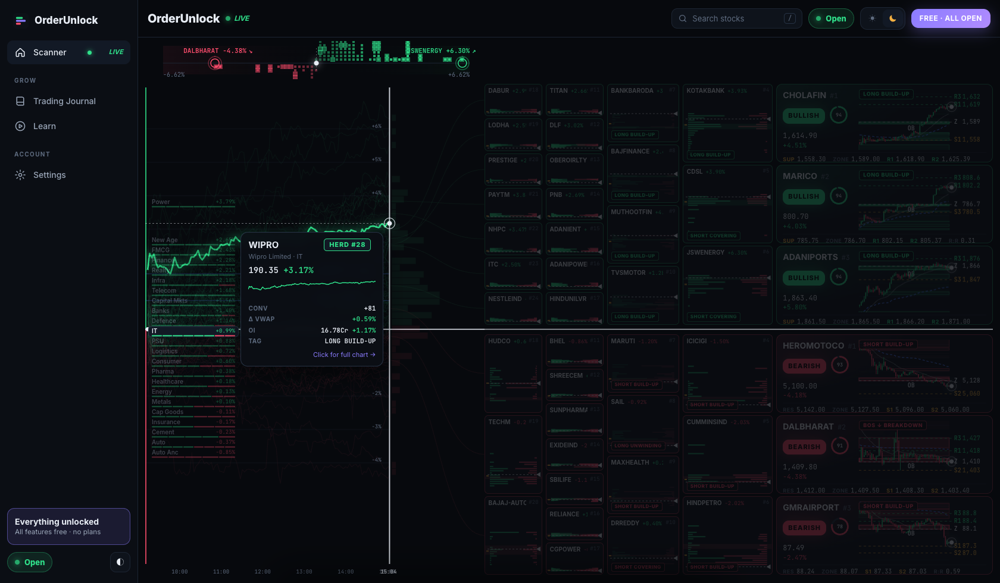
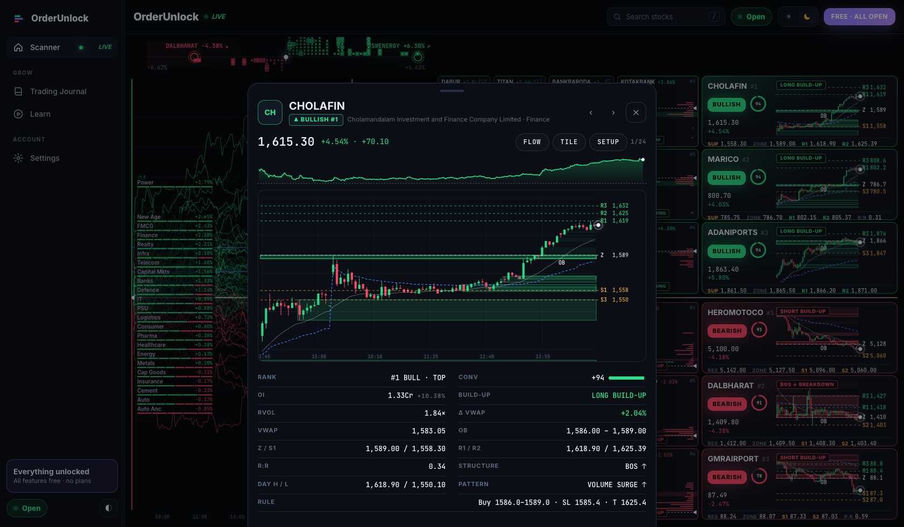
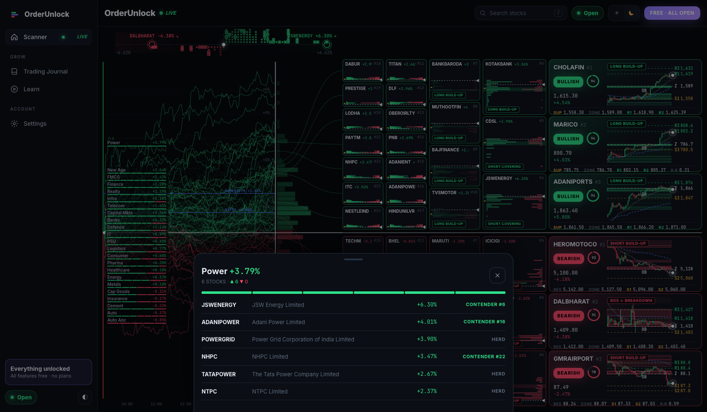
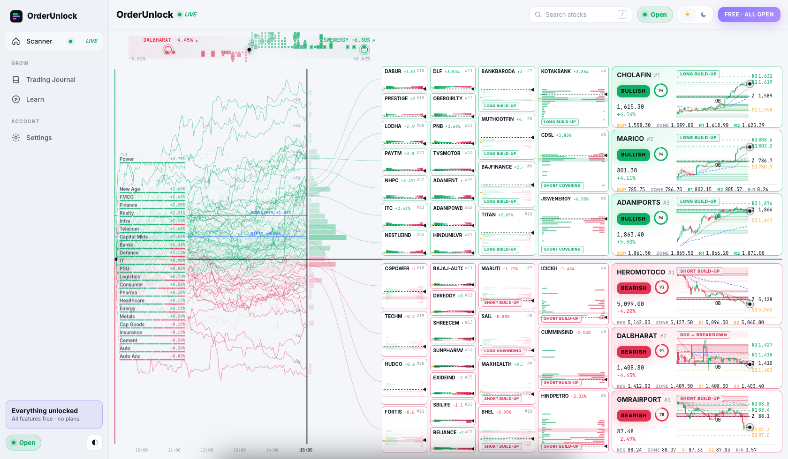
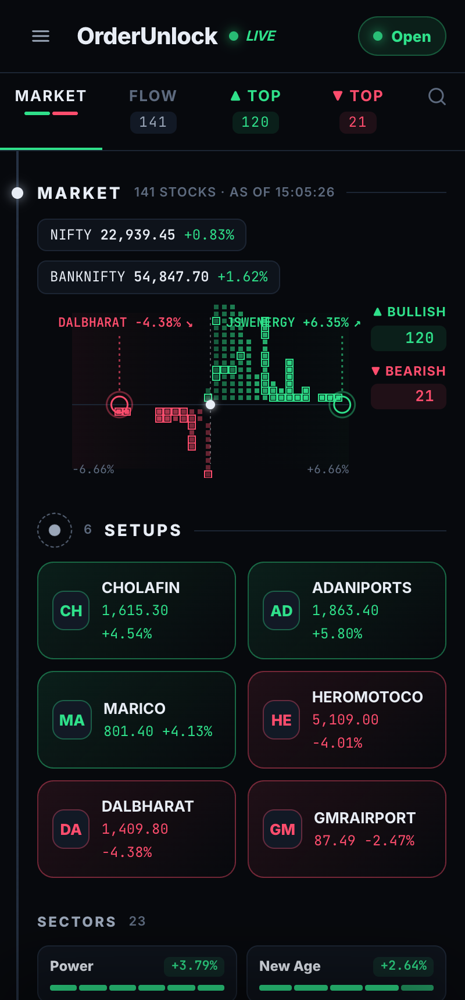
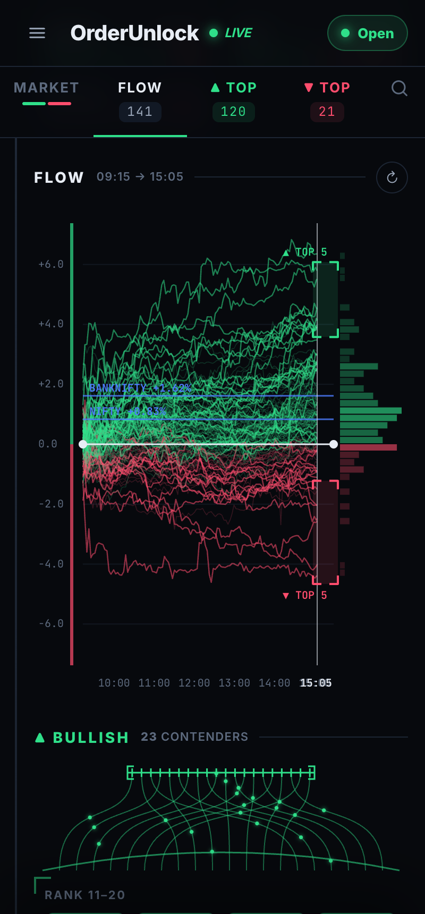
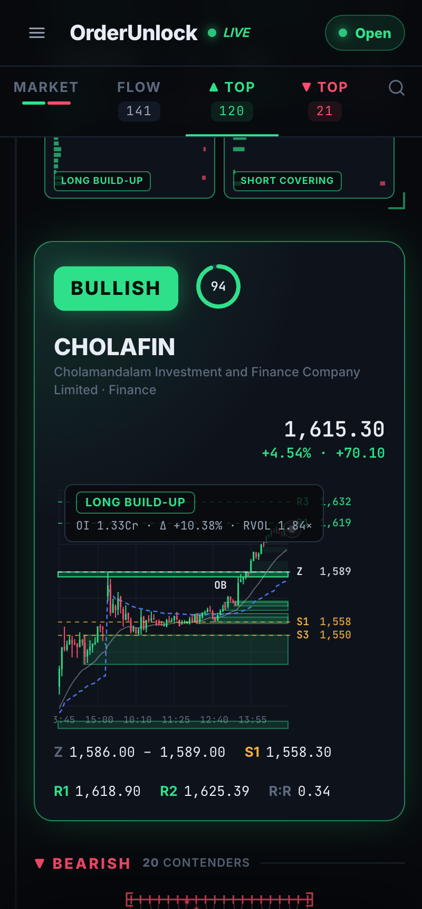

<div align="center">

# OrderUnlock

**Free, real-time order block scanner for NSE stocks: every feature open, no plans, no paywall.**

Live prices for 141 F&O stocks · order blocks, BOS, FVG, VWAP · real futures OI build-up from Upstox · flow → contenders → top setups pipeline



</div>

---

## Contents

- [Screens](#screens)
- [Features](#features)
- [Quick start](#quick-start)
- [Futures OI (Upstox)](#futures-oi-upstox)
- [How the analysis works](#how-the-analysis-works)
- [Architecture](#architecture)
- [API](#api)
- [Limits](#limits)

## Screens

| Hover spotlight on the flow | Stock modal |
|---|---|
|  |  |
| **Sector breakdown** | **Light theme** |
|  |  |

<p align="center">
  
  
  
</p>

## Features

### Desktop pipeline (≥ 1200 px): one screen, left to right

| Part | What it shows |
|---|---|
| **Market strip** | Every stock as a dot by % change. Stacks show breadth; the day's best and worst are ringed. Click a dot to open the stock. |
| **Flow** | Each stock's % change from previous close through the session. Green above the zero line, red below; NIFTY and BANKNIFTY in blue. A vertical *now* bar, then the end-of-session distribution. |
| **Sectors on the flow** | Each sector is pinned at its average % on the same scale as the flow, with one bar segment per stock. Hover a sector to light up its stocks' lines; click for the full list. |
| **Contender columns** | Ranks 18–24 → 11–17 → 7–10 → 4–6 per side, narrowing toward the top. Curves connect each line's endpoint to its card. Cards show a volume-by-price profile, live price, active OB band and build-up tag. |
| **Top setups** | The 3 strongest bullish and 3 strongest bearish setups: conviction ring, live chart with order blocks and levels, and the support / zone / resistance / R:R row. |
| **Hover spotlight** | Hovering any flow line makes it glow and dims everything else. Its sector row and card light up, and a quick-look popover shows price, rank, conviction, Δ VWAP, OI and tag. Hovering a card spotlights its line. |

### Mobile / narrow layout

The same data stacked vertically: Market → Setups (tap to jump, hold for details) → Sectors → Flow → Bullish contenders + #1 → Bearish contenders + #1, with sticky **MARKET · FLOW · ▲TOP · ▼TOP** tabs.

### Everywhere

- **Stock modal:** intraday sparkline, a 5-minute chart with order blocks (live and mitigated), FVGs, VWAP, EMA-20, Z / S1–S3 / R1–R3. Stats: Rank, Conviction, OI and ΔOI, Build-up, RVOL, Δ VWAP, VWAP, OB, Z/S1, R1/R2, R:R, Structure, Day H/L, Pattern, Rule. **FLOW / TILE / SETUP** buttons jump to that stock; **← / →** step through the list.
- **Search** (`/`): by symbol, company or sector.
- **Trading journal:** log long/short trades and see live mark-to-market P&L and win rate (stored in your browser).
- **Learn:** plain-language explanation of every metric and chart.
- **Settings:** theme and Upstox OI connection status.
- **Light & dark themes**, live market-status pill (IST hours), stale-data banner.

## Quick start

```bash
git clone https://github.com/vedantkhursange/OrderUnlock.git
cd OrderUnlock
npm start
```

Open **http://localhost:4173**. Requires Node 20+, with no dependencies and no build step. The first load takes ~1 minute while 5-day candles for every stock are fetched.

## Futures OI (Upstox)

OI works out of the box with no account:

| Mode | Source | Refresh |
|---|---|---|
| **Public** (default) | Upstox open candle API: previous-day OI from daily candles, today's OI from 1-minute candles | Every contract read at startup, then each one every ~2–3 min (paced under Upstox rate limits) |
| **Live** (optional) | Upstox full market quotes for all 136 contracts in one call | **Every 2 seconds** |

To enable live mode:

1. Create an app at <https://account.upstox.com/developer/apps> with redirect URL `http://localhost:4173/auth/upstox/callback`.
2. `cp .env.example .env` and fill in `UPSTOX_API_KEY` and `UPSTOX_API_SECRET`.
3. Restart, open **Settings → Connect Upstox** and sign in. The token lasts until 3:30 AM IST, so connect once per trading day.

`.env` and the saved token are git-ignored and never leave your machine.

**Build-up** is read from the near-month future: price ↑ + OI ↑ = *Long build-up*, price ↓ + OI ↑ = *Short build-up*, price ↑ + OI ↓ = *Short covering*, price ↓ + OI ↓ = *Long unwinding*.

## How the analysis works

All on 5-minute candles over the last 5 sessions, recomputed every second with the live price patched into the newest candle (`lib/engine.js`):

1. **Pivots:** fractal swing highs and lows (3 bars each side).
2. **Break of structure:** the first close beyond a swing. Its direction is the stock's structure.
3. **Order blocks:** the last opposite-colour candle before a BOS impulse of at least 1.2 × ATR. A block is *mitigated* once a candle closes through it.
4. **Fair value gaps:** unfilled 3-candle imbalances.
5. **Levels:** Z = nearest live OB edge; S1–S3 / R1–R3 = clustered swing lows/highs and day extremes.
6. **Conviction (−100…+100):** day change, distance from VWAP, EMA-20 slope, EMA 20/50 stack, last BOS, proximity to a live OB and OI build-up, scaled by relative volume.
7. **Ranking:** each side is sorted by conviction. #1 = TOP, 2–24 = contenders, the rest = herd.
8. **R:R:** to the first target ≥ 1 ATR away, against a stop just beyond the OB.

## Architecture

```
lib/universe.js   141 NSE F&O stocks by sector (+ NIFTY, BANKNIFTY)
lib/feed.js       Yahoo Finance chart API: 20-symbol spark batches (~1 s), 5-day 5-min candles round-robin, 429 back-off
lib/oi.js         Upstox: instrument master → near-month futures, prev-day + intraday OI, optional OAuth quotes
lib/engine.js     pivots, BOS, order blocks, FVG, VWAP, EMA, levels, conviction, R:R, tags
server.js         ranks both sides, Server-Sent Events: state every 1 s, flow every 15 s; static files; Upstox auth routes
public/           vanilla JS + canvas (app.js, pipeline.js, charts.js), no framework, no build
```

## API

| Endpoint | Returns |
|---|---|
| `GET /api/stream` | SSE: `state` (every 1 s) and `flow` (every 15 s) |
| `GET /api/state` | All stocks with price, change, score, rank, status, levels, OI, build-up |
| `GET /api/flow` | Per-stock session % series |
| `GET /api/stock/:sym` | Candles, VWAP, EMA, full analysis, intraday closes |
| `GET /api/oi/status` | OI mode, coverage and freshness |

## Limits

- Prices come from Yahoo Finance's public feed. They update about every second but can trail the exchange slightly; for tick-exact data, connect a broker websocket in `lib/feed.js`.
- Public-mode OI is minutes old; connect Upstox for 2-second OI.
- All levels and scores are OrderUnlock's own calculations.
- **Educational tool, not investment advice.** Trade at your own risk.

## License

MIT
